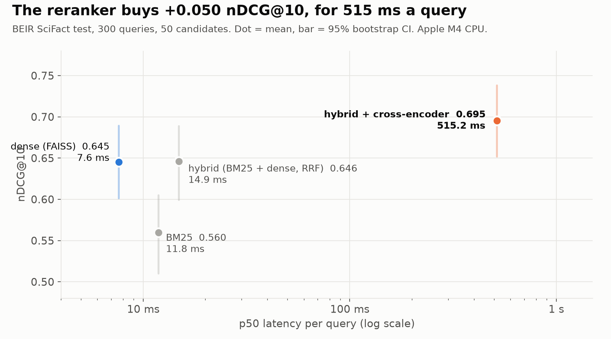
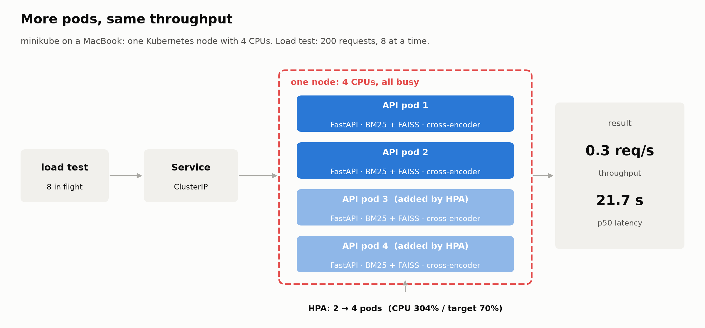

# Neural Rerank Engine

**A two-stage search service, run like a real one: FastAPI, Docker, Kubernetes, CI/CD and Prometheus.**

---

It searches 5,183 scientific abstracts (BEIR **SciFact**). Stage 1 finds 50 candidates with **BM25** (keywords) and
**FAISS** (embeddings), merged with Reciprocal Rank Fusion. Stage 2 re-orders them with a **cross-encoder**, a model
that reads the query and each document together.

## The numbers that matter

| | |
|:---:|:---|
| **+0.050** nDCG@10 | What the cross-encoder adds over retrieval alone, on the 300 SciFact test queries. |
| **515 ms** | The price: median latency per query with reranking, against 14.9 ms without. |
| **2 → 4 pods** | Kubernetes doubled the pods under load, and throughput stayed at 0.3 req/s. |
| **50 queries** | The first version's benchmark: too small and too easy to trust. |

  

---

## Similar is not relevant

In RAG work, vector search kept returning passages that *sounded* related but didn't answer the question. The gap
between "similar" and "relevant" is what a cross-encoder is meant to close, so the plan was to measure it.

## 0.8282 MRR on a test that was too easy

The first version used an MS MARCO subset and **MRR@10** (1 divided by the rank of the first correct result):

| Stage | MRR@10 |
|:---|:---:|
| BM25 | 0.5594 |
| dense (FAISS) | 0.7977 |
| hybrid + cross-encoder | 0.8282 |

The numbers looked good, but the test behind them was weak. It had 50 queries, the corpus was built from the first
passage of each query, and that same passage was counted as the answer, without checking MS MARCO's own relevance
labels. Hybrid search without the reranker was never measured, so there was no way to tell which stage did the work.

## Which stage actually does the work?

The service now runs on SciFact, so every stage was scored on its 300 test queries with the official BEIR labels
(`scripts/eval_quality.py`, chart above). **nDCG@10** scores the top 10 results and gives more credit when the
relevant abstracts are near the top.

- **Dense beats keywords:** +0.085 nDCG@10 over BM25.
- **Fusion adds nothing to the ranking:** +0.001 over dense alone. It only finds a few more relevant abstracts in
  the top 50 (recall 0.892 → 0.912).
- **The reranker is the only stage that moves the top 10:** +0.050 [+0.019, +0.081], but at 515 ms per query
  against 14.9 ms.

> Finding the right documents is cheap. Putting them in the right order is what costs half a second.

---

## From script to service

The search is a **FastAPI** app (`/health`, `/ready`, `/search`, `/metrics`) in a multi-stage **Docker** image that
bakes in the models and the index (2.1 GB, 532 MB compressed). **GitHub Actions** runs ruff and pytest on every push,
then builds the image for amd64 and arm64 and pushes it to ghcr.io. **Kubernetes** runs it with an autoscaler (HPA),
and **Prometheus** scrapes request counts and latency.

On the Mac, natively, one process serves 2.0 req/s with reranking (489 ms median) and 71.8 req/s without (13 ms).
Sending 4 requests at once doesn't help (1.8 req/s): one search already uses every CPU core.

The first load test in Kubernetes found a real bug. With 8 requests in flight, each pod ran 4 reranks in parallel,
went over its 2 Gi memory limit and got **OOMKilled**. Every rerank allocates a lot of temporary memory. The fix is a
semaphore in `api.py` that lets one search run per pod at a time (`MAX_CONCURRENT_SEARCHES=1`), at no throughput
cost, since one search already fills the pod's CPUs. A test now checks the limit.

## More pods, same throughput

  

Under load the autoscaler did its job: 2 → 4 pods, no restarts. Throughput still stayed at 0.3 req/s, with a median
latency of 21.7 s and 4 errors out of 200 requests. All the pods shared one minikube node with 4 CPUs, already
saturated, so new pods only split the same CPUs and requests waited in line.

These Kubernetes numbers come from a Docker VM limited to 4 CPUs and 8 GB, so they can't be compared with the native
ones above.

---

## Things that didn't pay off

- **The first MS MARCO benchmark**: 50 queries with unchecked labels.
- **Hybrid fusion**: no gain in nDCG@10 over dense alone on SciFact.
- **Autoscaling on a single node**: more pods, same throughput.

## If you build one of these

- **Measure each stage on its own** before stacking models, including hybrid without the reranker.
- **Check that the test set isn't too easy**, and that its labels are real.
- **Put latency next to accuracy** for every stage, so the trade-off is visible.
- **More pods only help when there is free CPU.** On a real cluster, that means more nodes.

## Next experiments

- A cheaper cross-encoder: ONNX or OpenVINO INT8.
- LLM listwise reranking over BM25 scores.
- MS MARCO dev with its real relevance labels.
- A multi-node cluster, to see autoscaling actually add throughput.

---

Quality: `results/quality_scifact.json` (`scripts/eval_quality.py`). Latency and Kubernetes numbers:
`scripts/load_test.py`, commands in [RUNBOOK.md](RUNBOOK.md). Every file is explained in
[docs/MLOPS_GUIDE.md](docs/MLOPS_GUIDE.md).
