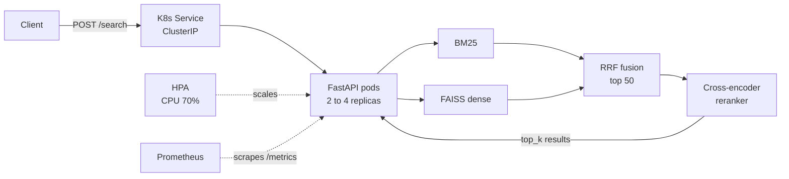

# Neural Rerank Engine

[](https://github.com/ALI-AL-MARJANI/Neural-Rerank-Engine/actions/workflows/ci.yml)


A two-stage search service, run like a production service: **FastAPI** API, **Docker** image,
**Kubernetes** deployment, **CI/CD with GitHub Actions** and **Prometheus** monitoring.

1. **Retrieval (recall):** BM25 (keywords, `rank_bm25`) + dense retrieval (FAISS, `all-MiniLM-L6-v2`),
   merged with **Reciprocal Rank Fusion** → top 50 candidates.
2. **Reranking (precision):** a **cross-encoder** (`cross-encoder/ms-marco-MiniLM-L-6-v2`) scores each
   (query, document) pair and re-orders the candidates.

Demo corpus: [BEIR SciFact](https://huggingface.co/datasets/BeIR/scifact), 5,183 public scientific abstracts.

---

## Architecture



```
Client ──► K8s Service (ClusterIP) ──► Pods (FastAPI, 2 to 4 replicas)
                                         │  BM25 ─┐
                                         │        ├─► RRF ─► top 50 ─► cross-encoder ─► top_k
                                         │  FAISS ┘
Prometheus ── scrapes GET /metrics ──────┘
```

## Project layout

```
src/rerank_engine/       Python package
  api.py                 FastAPI app (/health, /ready, /search, /metrics)
  engine.py              pipeline: hybrid retrieval -> optional reranking
  config.py              settings from environment variables
  retrievers/            sparse.py (BM25), dense.py (FAISS), fusion.py (RRF), hybrid.py
  rerankers/             bert_reranker.py (cross-encoder)
scripts/build_index.py   downloads SciFact + models, builds the indices
scripts/load_test.py     load test, prints p50/p90/p99 latency
tests/                   pytest (fake engine, no model download)
Dockerfile               multi-stage image, CPU-only torch, non-root
docker-compose.yml       API + Prometheus (+ Grafana)
k8s/                     Deployment, Service, ConfigMap, HPA, Prometheus
.github/workflows/ci.yml lint + tests, then build & push to ghcr.io
docs/MLOPS_GUIDE.md      detailed explanation of every file
RUNBOOK.md               step-by-step commands with expected output
```

## API

| Endpoint | Purpose |
| :--- | :--- |
| `GET /health` | Liveness: the process is running |
| `GET /ready` | Readiness: models and indices are loaded (503 otherwise) |
| `POST /search` | `{"query": str, "top_k": int = 10, "rerank": bool = true}` → `{"results": [{doc_id, text, score}], "latency_ms"}` |
| `GET /metrics` | Prometheus metrics (request count, latency histogram, status codes) |
| `GET /docs` | Interactive Swagger documentation |

Configuration (environment variables): `INDEX_DIR` (default `data/indices`), `DENSE_MODEL`, `RERANK_MODEL`,
`TOP_K` (number of candidates sent to the reranker, default 50).

---

## Run it

### 1. Local (Python)

```bash
python -m venv venv && source venv/bin/activate
make install        # CPU torch + dependencies + package
make index          # downloads SciFact and the models, builds data/indices (~1 min)
make run            # http://localhost:8000/docs
```

```bash
curl -X POST localhost:8000/search -H 'Content-Type: application/json' \
     -d '{"query": "vitamin D deficiency and multiple sclerosis", "top_k": 3}'
```

### 2. Docker

```bash
make docker-build   # the index and the models are built INTO the image
make docker-run     # http://localhost:8000/docs (no internet needed at runtime)
```

### 3. Docker Compose (API + monitoring)

```bash
make compose-up                               # API :8000, Prometheus :9090
docker compose --profile grafana up --build   # + Grafana :3000 (admin / admin)
```

### 4. Kubernetes (minikube)

```bash
make k8s-deploy     # minikube start + metrics-server + kubectl apply -f k8s/
make k8s-status     # pods should be Running and READY 1/1
make k8s-forward    # http://localhost:8000/docs
```

Full step-by-step commands, with what you should see: [RUNBOOK.md](RUNBOOK.md).

---

## CI/CD

`.github/workflows/ci.yml` runs on GitHub Actions:

- **CI** (every push and pull request): `ruff check .` then `pytest`. Tests use a fake engine, so
  they run in under a second and download no model.
- **CD** (push on `main` or tag `v*`, only if CI passed): builds the Docker image for
  `linux/amd64` and `linux/arm64` and pushes it to
  **`ghcr.io/ali-al-marjani/neural-rerank-engine`** with the tags `latest` and `sha-<commit>`
  (plus `1.2.3` for a tag `v1.2.3`). Authentication uses the built-in `GITHUB_TOKEN`, no secret to create.

## Monitoring

- Each request is logged on one line: `POST /search 200 523.4ms`.
- `GET /metrics` exposes Prometheus metrics, via `prometheus-fastapi-instrumentator`:
  `http_requests_total` (by handler, method, status), `http_request_duration_seconds` (histogram).
- Docker Compose and minikube both run a Prometheus that scrapes the API every 5 s. Useful queries:

```promql
sum(rate(http_requests_total{handler="/search"}[1m]))                       # requests per second
histogram_quantile(0.9, sum(rate(http_request_duration_seconds_bucket{handler="/search"}[5m])) by (le))  # p90 latency
sum(rate(http_requests_total{status="5xx"}[5m]))                             # errors per second
```

## Measured latency

Measured with `scripts/load_test.py` (client-side latency, `top_k=10`, 50 candidates reranked).
Hardware: **Apple M4 MacBook, 16 GB RAM, native Python 3.9 (CPU, no Docker)**.

| Setup | Requests | Concurrency | p50 | p90 | p99 | Throughput |
| :--- | ---: | ---: | ---: | ---: | ---: | ---: |
| Hybrid + rerank | 100 | 1 | 489 ms | 501 ms | 541 ms | 2.0 req/s |
| Hybrid + rerank | 200 | 4 | 2248 ms | 2408 ms | 2568 ms | 1.8 req/s |
| Hybrid only (`rerank=false`) | 200 | 1 | 13 ms | 17 ms | 23 ms | 71.8 req/s |

The cross-encoder dominates the cost (50 forward passes on long abstracts). With 4 parallel requests,
throughput stays at ~2 req/s (latency grows ~4x): one process already uses all CPU cores, so requests wait in line.
This is why the service scales **horizontally** (more pods, HPA).

Startup (loading models + indices): 11.3 s on the same machine.
Docker and Kubernetes numbers: *to be measured* (see [RUNBOOK.md](RUNBOOK.md)).

No retrieval-quality metric (MRR, nDCG) is reported for now.

## Limitations

Runs locally on minikube (no cloud), CPU only (no GPU), no authentication, basic monitoring
(no alerting, no tracing). Details in [docs/MLOPS_GUIDE.md](docs/MLOPS_GUIDE.md#limitations).
